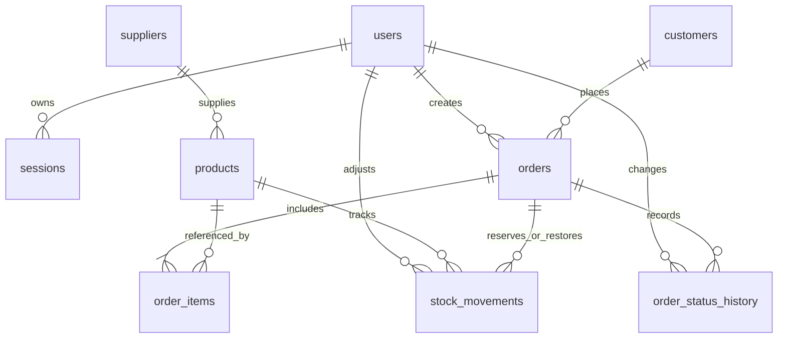

# Database relationships and integrity

SQLite schema is created in `server/db.js` when the application starts. All seeded data is fictional.

## Main tables

| Table | Key fields | What it protects |
| --- | --- | --- |
| `users` | id, email (unique), hashed password, role | Named actors for permission and audit |
| `sessions` | token_hash (primary), user_id, expiry | Server-verifiable session records |
| `suppliers` | id, name, contact | Supplier directory |
| `customers` | id, name, email, phone | Customer directory |
| `products` | id, sku (unique), price_cents, qty, low_stock_at, supplier_id | Current stock and current catalogue prices |
| `orders` | id, customer_id, status, subtotal_cents, created_by, timestamps | State machine and order totals |
| `order_items` | order_id, product_id, name_snapshot, sku_snapshot, unit_price_cents, qty | Historical prices; unique order-product pairs |
| `stock_movements` | product_id, order_id, delta, before_qty, after_qty, actor_id, reason, created_at | Inventory audit; unique (product_id, order_id, reason) |
| `order_status_history` | order_id, from_status, to_status, actor_id, detail, created_at | Every status transition, including initial draft |

## Important constraints

- `products.qty >= 0`, `order_items.qty > 0`, prices non-negative.
- Foreign keys enabled on every connection.
- Unique product SKU and unique product per order.
- Unique `(product_id, order_id, reason)` stock movement prevents duplicate reservation/restock entries.
- Transactional confirmation: `BEGIN IMMEDIATE`, check entire order, subtract all quantities, write movements, change status, write history, commit.
- Transactional cancellation: add stock only for confirmed or packed orders, write movements and history, commit.
- Transactions roll back on any conflict, leaving stocks and statuses unchanged.
- Every manual adjustment records `actor_id` and free-text reason; the product editor cannot alter quantity.

## Indexes

`idx_orders_status_date (status, created_at)`, `idx_order_items_order (order_id)`, `idx_stock_product_date (product_id, created_at)`, `idx_products_name (name)`. Unique keys and foreign key references create additional internal lookup indexes where appropriate.

## Why prices are integers

The app stores prices in `price_cents` as **paisa** to avoid rounding errors when multiplying order line prices by quantities. A product price update only changes `products`; historical `order_items.unit_price_cents` remains unchanged.
